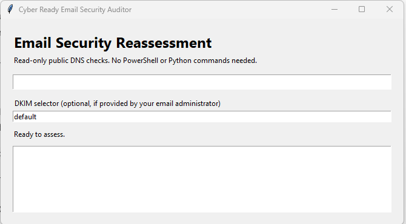

# Email Security Auditor

**Cyber Ready Clinic Capstone Project**

A Windows-based email security assessment tool designed to help small businesses and nonprofit organizations evaluate their email authentication configurations, identify potential security weaknesses, and generate actionable reports.

The application performs read-only public DNS assessments of **SPF (Sender Policy Framework), DKIM (DomainKeys Identified Mail), and DMARC (Domain-based Message Authentication, Reporting, and Conformance)**.

## Application Screenshot

## Download Email Security Auditor

**Latest Windows release: v1.0.1**

[**Download CyberReadyAudit.exe — Windows Application**](https://github.com/cjseipp/email-security-auditor/releases/download/v1.0.1/CyberReadyAudit.exe)

The Windows executable does not require a separate Python installation.

For earlier versions, visit the [GitHub Releases page](https://github.com/cjseipp/email-security-auditor/releases).

## Installation and Use

1. Download `CyberReadyAudit.exe` from the link above.
2. Save the executable to a folder on your Windows computer.
3. Double-click `CyberReadyAudit.exe` to launch the application.
4. Enter the domain you want to assess.
5. Confirm, change, or clear the optional DKIM selector (initially `default`).
6. Click **Run Assessment and Create Client Package**.
7. Review the SPF, DKIM, and DMARC findings and generated reports.

The application does not require administrative access to the domain or make changes to DNS records.

## Features

- SPF record discovery and assessment
- DKIM selector DNS lookup
- DMARC record and policy assessment
- Findings with recommended next steps
- Windows desktop graphical interface
- Streamlit browser-based interface for Python users
- Automated client report package generation
- Supporting technical evidence

## Client Report Package

Each completed assessment generates a ZIP package containing:

| File | Description |
|---|---|
| `01_Executive_Summary.pdf` | Management-level overview |
| `02_Email_Security_Dashboard.html` | Browser-based assessment dashboard |
| `03_Remediation_Action_Plan.pdf` | Recommended corrective actions |
| `04_Technical_Findings.xlsx` | Detailed technical findings |
| `05_Client_Instructions.pdf` | Guidance for interpreting the assessment |
| `Technical_Evidence/` | Supporting DNS evidence |

## Security and Limitations

- The application performs read-only public DNS checks.
- No DNS configurations are modified.
- A successful DKIM selector lookup does not prove that outgoing email is signed.
- DNS lookup failures should be verified before drawing security conclusions.
- Assessment findings should be reviewed before implementing remediation changes.
- The Windows executable is not digitally signed and may trigger a Windows security warning.

Download the executable only from the official GitHub release and compare its SHA-256 checksum with the value displayed in the release assets.

## Source Code

The repository contains the Python application source, tests, dependency requirements, and Windows installation and build scripts.

Developers can review the source code or build the application using the files provided in this repository.

## Project Purpose

Developed as a Cyber Ready Clinic capstone project, Email Security Auditor demonstrates practical application of cybersecurity assessment, email authentication analysis, risk identification, technical evidence collection, and client-focused reporting.

The project is intended to help organizations better understand their email security posture and identify opportunities for improvement.
